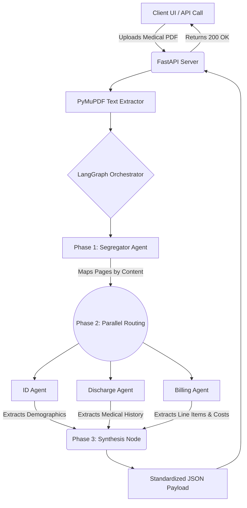

# AI Medical Claim Processing Pipeline

**Live API Deployment (Render):** <https://claim-processing-pipeline-7cdf.onrender.com/>

An end-to-end, AI-driven document orchestration pipeline that processes multi-page medical claims, extracts structured data using parallel AI agents, and outputs standardized JSON for downstream healthcare systems.

Built with **LangGraph**, **FastAPI**, and robust LLM integration, this project is optimized for **local execution** using Docker, ensuring data privacy and modular deployment.

*(Note: Be sure to take a screenshot of your frontend and save it as `frontend-screenshot.png` inside an `assets` folder in your repository!)*

## Key Features

* **Multi-Agent Orchestration:** Utilizes LangGraph to manage complex, stateful workflows between specialized AI agents.

* **Parallel Extraction:** Extracts Identity, Discharge, and Billing data simultaneously to drastically reduce processing time.

* **Intelligent Document Segregation:** Automatically classifies and routes specific pages of a massive PDF to the correct downstream agent.

* **Structured Output:** Forces the LLM to return strictly validated JSON using Pydantic schemas.

* **Local-First & Dockerized:** Packaged in a lightweight Python container for seamless local execution on any machine.

* **Rate-Limit Resilient:** Implements a custom "stagger hack" to successfully execute highly parallelized cloud LLM requests when local hardware is insufficient.

## Architecture & Workflow

Below is the architecture for the local execution pipeline:



The pipeline is divided into three core phases:

1. **Phase 1: Ingestion & Segregation**

   * A local FastAPI backend receives a raw medical PDF.

   * `PyMuPDF` extracts the raw text.

   * A **Segregator Agent** analyzes the document and maps specific pages (e.g., "Page 1 is a claim form, Pages 9-10 are itemized bills").

2. **Phase 2: Parallel Extraction**

   * **ID Agent:** Extracts patient demographics and insurance policy details.

   * **Discharge Agent:** Extracts admission/discharge dates, physician details, and diagnoses.

   * **Billing Agent:** Extracts all line items, calculates costs, and verifies totals across multiple bill pages.

   * *Note: These agents run in parallel using LangGraph's branching capabilities.*

3. **Phase 3: Synthesis**

   * The graph merges the structured outputs from all parallel agents into a final, unified JSON payload.

## Technology Stack

* **Orchestration:** LangGraph, LangChain

* **API & Backend:** FastAPI, Uvicorn, Python 3.12

* **LLM Provider:** Ollama (Local Inference) / Groq (Cloud Inference fallback)

* **Document Processing:** PyMuPDF

* **Deployment:** Docker (Local Containerization)

## Setup & Execution

Detailed instructions for running this pipeline locally (via Virtual Environment or Docker) and configuring the LLM providers (Ollama or Groq) can be found in the setup guide:

[**View the Local Execution Instructions**](instructions.md)

## Known Constraints & Limitations

* **Groq Free-Tier Token Limits:** If opting to use Groq's cloud models (e.g., `qwen/qwen3.8-27b`) instead of local Ollama inference, you will hit strict free-tier limits (7,000 Input Tokens Per Minute). Because Phase 2 executes 3 agents in parallel, large PDFs will immediately trigger a `429 Rate Limit Exceeded` error.

* **The "Stagger Hack" Delay:** To bypass the Groq rate limits, this codebase includes a `FREE_TIER` environment variable that forcibly sleeps specific nodes (up to 125 seconds) to stagger API calls into different 1-minute token windows. This drastically increases end-to-end processing time.

* **HTTP Timeouts:** Because of the stagger hack, synchronous API requests can take over 2-3 minutes. If deploying behind a reverse proxy (like Nginx) or a cloud provider's load balancer, this may trigger a `502 Bad Gateway` or `504 Gateway Timeout`. A task-queue architecture (e.g., Celery/Redis) is recommended for production cloud deployments.

* **Local Hardware Requirements:** Running 100% locally via Ollama requires sufficient RAM and processing power. The Qwen 3B/8B models require at least 8GB to 16GB of RAM to process documents efficiently without severe bottlenecking.

## API Reference

**Endpoint:** `POST /api/process`

**Request:** `multipart/form-data`

* `file`: The medical claim PDF document.

* `claim_id`: (Optional) A unique identifier string for the claim.

**Real Execution Response:**
The following JSON is the actual output generated by the pipeline when processing the included `final.pdf` (an 18-page sample medical claim document containing demographic forms, itemized bills, and a discharge summary):

```
{
  "claim_id": "CLM-2024-789456",
  "patient_identity": {
    "patient_name": "John Michael Smith",
    "dob": "1985-03-15",
    "id_numbers": [
      "ID-987-654-321",
      "PAT-789456"
    ],
    "policy_details": "HealthCare Insurance Company, Policy Number: POL-987654321, Group Number: GRP-12345, Subscriber: John Michael Smith (Self), Effective Date: 2024-01-01, Status: ACTIVE"
  },
  "discharge_details": {
    "diagnosis": "Community Acquired Pneumonia (CAP)",
    "admission_date": "January 20, 2025",
    "discharge_date": "January 25, 2025",
    "physician_details": "Dr. Sarah Johnson, MD"
  },
  "billing_details": {
    "line_items": [
      {
        "description": "Room Charges - Semi-Private (5 days)",
        "cost": 1000
      },
      {
        "description": "Admission Fee",
        "cost": 150
      },
      {
        "description": "Emergency Room Services",
        "cost": 500
      },
      {
        "description": "Physician Consultation - Dr. Sarah Johnson",
        "cost": 750
      },
      {
        "description": "Chest X-Ray",
        "cost": 240
      },
      {
        "description": "CT Scan - Chest",
        "cost": 800
      },
      {
        "description": "Complete Blood Count (CBC)",
        "cost": 135
      },
      {
        "description": "Blood Culture Test",
        "cost": 160
      },
      {
        "description": "Arterial Blood Gas Analysis",
        "cost": 95
      },
      {
        "description": "IV Fluids - Normal Saline",
        "cost": 250
      },
      {
        "description": "Injection - Ceftriaxone 1g",
        "cost": 150
      },
      {
        "description": "Injection - Paracetamol",
        "cost": 48
      },
      {
        "description": "Nebulization Treatment",
        "cost": 140
      },
      {
        "description": "Oxygen Therapy (per hour)",
        "cost": 240
      },
      {
        "description": "Nursing Care (per day)",
        "cost": 500
      },
      {
        "description": "ICU Monitoring Equipment",
        "cost": 400
      },
      {
        "description": "Physiotherapy Session",
        "cost": 180
      },
      {
        "description": "Medical Supplies & Consumables",
        "cost": 250
      },
      {
        "description": "Laboratory Processing Fee",
        "cost": 75
      },
      {
        "description": "Pharmacy Dispensing Fee",
        "cost": 50
      },
      {
        "description": "Amoxicillin 500mg Capsules",
        "cost": 31.5
      },
      {
        "description": "Acetaminophen 500mg Tablets",
        "cost": 16
      },
      {
        "description": "Cetirizine 10mg Tablets",
        "cost": 9
      },
      {
        "description": "Omeprazole 20mg Capsules",
        "cost": 16.8
      },
      {
        "description": "Albuterol Inhaler",
        "cost": 35
      },
      {
        "description": "Vitamin D3 1000 IU",
        "cost": 12
      },
      {
        "description": "Probiotic Capsules",
        "cost": 25.5
      },
      {
        "description": "Saline Nasal Spray",
        "cost": 8.5
      },
      {
        "description": "Antiseptic Mouthwash 250ml",
        "cost": 12
      },
      {
        "description": "Digital Thermometer",
        "cost": 15
      },
      {
        "description": "Medication Counseling",
        "cost": 25
      },
      {
        "description": "Home Delivery Service",
        "cost": 10
      }
    ],
    "total_amount": 6625
  }
}

```
